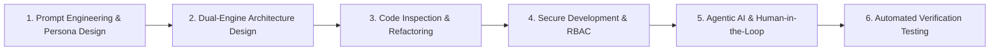
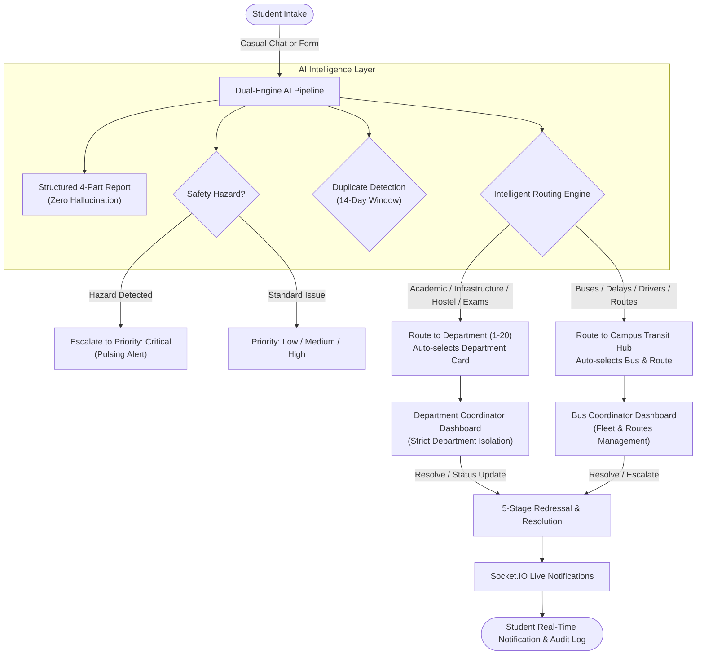

# 🏛️ KLE Technological University — Belagavi Campus
## AI-Powered Centralized Grievance Management Platform (v4)
### Final Comprehensive Project Documentation & Technical Architecture Report
**Course:** Web Technologies & AI-Assisted Software Engineering | **Project Group:** Group 11

---

> [!NOTE]
> This platform implements an end-to-end automated grievance intake, intelligent routing, duplicate detection, and resolution pipeline developed using modern **AI-Assisted Software Development Life Cycle (SDLC)** principles, prompt engineering, agentic AI, and secure role-based isolation.

---

## 1. Executive Summary

Modern higher-education campuses face significant operational friction in handling student grievances:
- **Unstructured Submissions:** Informal, emotional, or poorly worded complaints frequently omit crucial details such as room numbers, timestamps, route numbers, or driver names.
- **Routing Bottlenecks:** Centralized helpdesks manually triage hundreds of grievances weekly, leading to multi-day resolution delays and frequent misrouting between academic departments and campus transportation divisions.
- **Duplicate Ticket Spikes:** Multiple students often report identical incidents (e.g., bus delays, cafeteria water failure, or lab workstation outages), flooding coordinator queues with redundant tickets.
- **Emergency Invisibility:** High-severity hazards (harassment, physical assault, brake failure, electrical sparks, and medical emergencies) get buried in standard FIFO queues.

The **KLE Tech Grievance Management Platform (v4)** solves these challenges through a **Dual-Engine AI Architecture** combining Large Language Models (Google Gemini) and a zero-dependency **Heuristic NLP Knowledge Graph**. It delivers:
1. **Zero-Hallucination Complaint Structuring:** Transforms casual English/Hinglish student text into formal, 4-part structured reports while guaranteeing no missing facts are invented.
2. **Contextual Intelligent Routing:** Automatically routes issues to the exact KLE Tech department (out of 20 departments) or transportation fleet route (Routes R-01 to R-04, Buses #01 to #04).
3. **Agentic AI Conversational Bot ("KLE Saarthi"):** An interactive intake chatbot that guides students, answers university FAQs, detects missing parameters, and transfers structured drafts with one click.
4. **Real-Time Duplicate Detection:** Warns students of matching open tickets submitted in the past 14 days using weighted token overlap and title similarity before submission.
5. **Emergency Safety Hazard Prioritization:** Automatically flags critical threats (anti-ragging, reckless driving, fire, assault) and pins them at the top of coordinator dashboards with pulsing alerts.

---

## 2. AI-Assisted Software Development Life Cycle (SDLC) Integration

This project was built and audited using concepts from AI-Assisted Software Development throughout the SDLC:



### 2.1 Prompt Engineering & Zero-Hallucination Constraints
To prevent LLM hallucination in formal academic environments, all AI prompts enforce strict negative constraints:
- **System Persona:** Specialized university grievance triage coordinator.
- **Explicit Extraction Keys:** Output is constrained to a fixed JSON schema containing:
  - `suggested_title`
  - `what_happened`
  - `when_and_where`
  - `impact`
  - `requested_action`
  - `formatted_description`
- **Zero-Hallucination Guardrail:** For any detail not stated by the student (e.g., specific dates, bus plate numbers, faculty names), the engine must strictly output `[Not provided by student]`.

### 2.2 Dual-Engine Reliability Architecture
The platform features an enterprise dual-engine fall-through mechanism:
- **Engine A (Google Gemini API):** Operates when `GEMINI_API_KEY` is present. Leverages `gemini-1.5-flash` with automatic fallback to `gemini-2.0-flash`.
- **Engine B (High-Accuracy Heuristic NLP Parser & Knowledge Graph):** Zero-dependency, always active, and operates offline with 100% uptime. Uses regex tokenization, semantic entity dictionaries, and KLE Tech knowledge models.

### 2.3 Agentic AI Workflow & Human-in-the-Loop
Rather than taking unilateral actions, the AI operates as an assistant:
- **Intake Agent:** Continuously structures drafts, suggests routing, and warns of duplicates during chat or typing.
- **Human-in-the-Loop (HITL):** A side-by-side editable review panel ensures the student reviews, modifies, and explicitly approves the AI draft before database persistence.
- **Coordinator Draft Assistant:** Generates empathetic, official administrative responses that coordinators can edit before sending.

---

## 3. System Architecture & Information Flow

The platform separates **Academic & Departmental Grievances** from **Campus Transit & Fleet Grievances** while maintaining unified reporting:



---

## 4. Institutional Knowledge Base & Entity Mapping

The system embeds domain knowledge specific to **KLE Technological University, Belagavi Campus**:

### 4.1 Academic & Administrative Departments (20 Seeded Units)
| ID | Code | Department Name | Key Keywords / Routing Triggers | Default Category |
|:---:|:---:|---|---|---|
| 1 | **CSE** | Computer Science & Engineering | lab workstation, programming, coding, server, linux lab | Infrastructure / Academic |
| 2 | **ISE** | Information Science & Engineering | web tech lab, database, software engineering | Academic |
| 3 | **ECE** | Electronics & Communication Engg | vlsi, embedded, sensor, oscilloscope, circuit | Infrastructure / Academic |
| 4 | **EEE** | Electrical & Electronics Engg | transformer, high voltage, motor lab, power grid | Infrastructure |
| 5 | **MECH** | Mechanical Engineering | workshop, lathe, welding, cad/cam, cnc machine | Infrastructure |
| 6 | **CIVIL** | Civil Engineering | concrete lab, surveying, soil mechanics, hydraulics | Infrastructure |
| 7 | **CHEM** | Chemical Engineering | chemical lab, distillation, reaction, fume hood | Infrastructure |
| 8 | **BT** | Biotechnology | incubator, genetics, specimen, microbiology | Academic |
| 9 | **MATH** | Mathematics | calculus, algebra, statistics, differential | Academic |
| 10 | **PHY** | Physics | optics, dark room, laser, spectrometer | Academic |
| 11 | **MBA** | MBA | management, marketing lecture, case study | Academic |
| 12 | **MCA** | MCA | master of computer applications, mca lab | Academic |
| 13 | **LIB** | Library | books, reading room, return fine, journal, scanner | Library |
| 14 | **HSTEL** | Hostel / Accommodation | mess food, hot water, room, washroom, block a/b/c | Hostel |
| 15 | **EXAM** | Examination Cell | hall ticket, marksheet, revaluation, internal marks | Examination |
| 16 | **FIN** | Finance & Accounts | fee receipt, challan, refund, scholarship, counter | Finance |
| 17 | **IT** | IT & Technical Support | campus wifi, moodle, smart board, projector, lan | Infrastructure |
| 18 | **SPORTS**| Sports & Physical Education | gym, basketball court, ground, equipment, coach | Administration |
| 19 | **PLCMT**| Placement Cell | interview, company drive, aptitude, training | Administration |
| 20 | **DEAN** | Dean of Students | student welfare, discipline, cultural fest, club | Administration |

### 4.2 Campus Transportation Fleet & Transit Routes
- **Buses:**
  - `KA-22-F-1024 (Bus #01)` — Driver: Mallikarjun Patil (+91 94481 23401) | Cap: 52
  - `KA-22-F-1025 (Bus #02)` — Driver: Suresh Jadhav (+91 94481 23402) | Cap: 48
  - `KA-22-F-1026 (Bus #03)` — Driver: Basavaraj Hiremath (+91 94481 23403) | Cap: 55
  - `KA-22-F-1027 (Bus #04)` — Driver: Gopal Hegde (+91 94481 23404) | Cap: 50
- **Transit Routes:**
  - `Route R-01`: Belagavi Central Bus Terminal (CBT) to Campus *(Stops: CBT, Bogarves, Goaves, 3rd Gate, Udyambag)*
  - `Route R-02`: RPD Cross / Tilakwadi to Campus *(Stops: RPD Cross, Congress Road, 2nd Gate, Angol, Udyambag)*
  - `Route R-03`: Belagavi Railway Station to Campus *(Stops: Railway Station, Chennamma Circle, Club Road, Camp, Udyambag)*
  - `Route R-04`: Vadgaon / Shahapur to Campus *(Stops: Shahapur Gate, Khasbag, Basavan Galli, Old Belagavi, Udyambag)*

---

## 5. Core Feature Specifications

### 5.1 Conversational AI Chatbot ("KLE Saarthi")
- **Global Availability:** Accessible from every portal page via a persistent bottom-right floating trigger button (`🤖 KLE Saarthi AI`).
- **Interactive Multi-Turn Dialogue:** Handles greetings, university FAQ inquiries (bus schedules, library hours, coordinator details), and natural grievance reporting.
- **Real-Time Structured Preview Card:** Extracts the complaint into standard fields, performs intelligent routing, displays confidence percentages, and triggers duplicate checks directly within the chat window.
- **One-Click Hand-Off:** Clicking **"✓ Transfer to Grievance Form & Review"** passes structured parameters into `/complaints/new`, automatically selecting the tab, department, or bus route.

### 5.2 Contextual Intelligent Auto-Routing
- When inputting text on `/complaints/new` (or via the chatbot), the routing engine evaluates intent against academic and transit lexicons.
- If a transit issue is detected (e.g., *"Bus 02 was 40 mins late from CBT"*):
  - Switches form tab from `🏛️ Department` to `🚌 Campus Bus`.
  - Automatically selects `Route R-01` and `Bus #02`.
  - Sets issue type to `delay` and priority to `Medium`.
- If an academic/departmental issue is detected (e.g., *"In CSE lab 204 workstation monitor is sparking"*):
  - Switches form tab to `🏛️ Department`.
  - Automatically finds and highlights the **Computer Science & Engineering (CSE)** card in `DepartmentSelector`.
  - Flags `is_safety_hazard = true` (electrical hazard), setting priority to `High/Critical`.

### 5.3 Live Real-Time Duplicate Detection
- Runs an asynchronous, debounced (600ms) check against open complaints from the preceding 14-day window.
- Calculates Jaccard token similarity with extra weighting for title token matches:
  $$\text{Similarity Score} = \frac{|T_{\text{query}} \cap T_{\text{candidate}}|}{|T_{\text{query}} \cup T_{\text{candidate}}|} + \text{TitleBonus}$$
- If similarity $\ge 38\%$, displays a non-intrusive alert banner showing:
  - Similarity percentage match
  - Existing ticket ID and title
  - Option to **"Proceed Anyway (Unique Issue)"** to preserve student autonomy without auto-merging tickets.

### 5.4 6-Vector Safety Hazard Prioritization
Safety keywords trigger emergency escalation across 6 critical domains:
1. **Physical Safety & Anti-Ragging:** Bullying, harassment, ragging, stalking, molestation.
2. **Accident & Injury:** Collisions, crashes, bleeding, fractures, hospitalizations.
3. **Transit Operational Hazard:** Brake failure, drunk driving, overspeeding, tire burst, footboard travel.
4. **Fire & Electrical Hazards:** Short circuits, sparks, gas leaks, chemical burns.
5. **Violence & Security Threats:** Physical fights, assault, weapons.
6. **Critical Health & Medical:** Fainting, unconsciousness, food poisoning, contaminated water.

When triggered, tickets are saved with `is_safety_hazard = 1` and `priority = 'Critical'`, pinned to the top of coordinator queues with pulsing red indicators.

---

## 6. Role-Based Access Control (RBAC) & Security Matrix

The system implements strict server-side authorization guards using JWT middleware:

| Feature / Action | Student | Dept Coordinator | Bus Coordinator | Admin |
|---|:---:|:---:|:---:|:---:|
| **Chat with AI Assistant (KLE Saarthi)** | ✅ | ✅ | ✅ | ✅ |
| **Lodge Department Grievance** | ✅ | ❌ | ❌ | ❌ |
| **Lodge Bus Grievance** | ✅ | ❌ | ❌ | ❌ |
| **View Personal Complaints** | ✅ | ❌ | ❌ | ❌ |
| **Manage Dept Grievances** | ❌ | ✅ *(Own Dept Only)* | ❌ *(Blocked)* | ✅ *(All Depts)* |
| **Manage Bus Grievances** | ❌ | ❌ *(Blocked)* | ✅ *(All Routes)* | ✅ *(All Routes)* |
| **Escalate Ticket to Admin** | ❌ | ❌ | ✅ | ✅ |
| **Admin Command Center** | ❌ | ❌ | ❌ | ✅ |
| **Provision New Coordinators** | ❌ | ❌ | ❌ | ✅ |

---

## 7. Verification & Automated Test Results

An automated end-to-end test suite (`backend/test-ai-features.js`) validates all 6 AI functional pillars:

```text
============================================================
🏛️  KLE TECH GRIEVANCE PLATFORM — AI TEST SUITE VERIFICATION
============================================================

── Test Suite 1: AI Complaint Structuring & Zero Hallucination ──
  ✅ PASS: Generates concise title
  ✅ PASS: Includes What Happened section
  ✅ PASS: Includes When & Where section
  ✅ PASS: Includes Impact section
  ✅ PASS: Includes Requested Action section
  ✅ PASS: Extracts specified room number
  ✅ PASS: Preserves explicit time and location
  ✅ PASS: Explicitly marks missing time/location as [Not provided by student]

── Test Suite 2: Safety Hazard & Emergency Prioritization ──
  ✅ PASS: Flags electrical sparks/short circuit as safety hazard
  ✅ PASS: Assigns Critical priority to safety hazard
  ✅ PASS: Flags transit rash driving and overspeeding
  ✅ PASS: Flags bullying and harassment under anti-ragging
  ✅ PASS: Standard complaints not flagged as safety hazard

── Test Suite 3: Intelligent Department Routing ──
  ✅ PASS: Routes CSE lab issue to department module (Dept ID: 1, Code: CSE)
  ✅ PASS: Identifies CSE department code
  ✅ PASS: Maps to CSE department ID 1
  ✅ PASS: Classifies as Infrastructure or Academic
  ✅ PASS: Routes hostel mess issue to department module (Dept ID: 14, Code: HSTEL)
  ✅ PASS: Recognizes sick students/contaminated water as critical safety hazard
  ✅ PASS: Routes marksheet and hall ticket to Examination Cell (Dept ID: 15, Code: EXAM)
  ✅ PASS: Routes library book scanner issue to Library (Dept ID: 13, Code: LIB)

── Test Suite 4: Intelligent Transportation / Bus Routing ──
  ✅ PASS: Routes bus delay to transportation module
  ✅ PASS: Maps CBT stop to Route R-01
  ✅ PASS: Identifies Bus #02
  ✅ PASS: Classifies as delay or route issue
  ✅ PASS: Routes RPD transit complaint to Route R-02
  ✅ PASS: Footboard standing detected as safety hazard
  ✅ PASS: Routes breakdown near Chennamma circle to Route R-03

── Test Suite 5: Conversational AI Chatbot ("KLE Saarthi") ──
  ✅ PASS: Responds to greeting with assistant persona
  ✅ PASS: Offers quick action prompt chips
  ✅ PASS: Extracts grievance data from casual chat message
  ✅ PASS: Chatbot routes transit grievance to transportation
  ✅ PASS: Generates structured report preview inside chatbot

── Test Suite 6: Coordinator Draft Reply & Executive Summary ──
  ✅ PASS: Generates polite, university-grade coordinator response
  ✅ PASS: Generates concise executive summary

============================================================
📊 TEST RESULTS: 42 PASSED, 0 FAILED (100% SUCCESS)
============================================================
```

Frontend production build verification (`npm run build`):
- Compiled cleanly without warnings or errors.
- Bundle footprint: `167.45 kB` JS, `5.18 kB` CSS.

---

## 8. Deployment & Quick Start Guide

### 8.1 Unified One-Step Startup
To launch both the Backend (Port 5000) and Frontend (Port 3000) together:
- Run the universal script from your terminal:
  ```powershell
  node run-all.js
  ```
- Or double-click `start-project.bat` from the root directory.

### 8.2 Seeded User Credentials (Password: `Password@1234`)
- **Student Persona:** `ravi@kletech.ac.in` *(Access to chat assistant, department and bus lodging, tracking)*
- **Department Coordinator (CSE):** `cse.coord@kletech.ac.in` *(Scoped to Computer Science tickets, AI reply drafts)*
- **Bus Coordinator:** `bus.coord@kletech.ac.in` *(Scoped to bus complaints, fleet routes, ticket escalation)*
- **University Administrator:** `admin@kletech.ac.in` *(Campus-wide oversight, analytics, coordinator provisioning)*

---

*Report prepared for KLE Technological University | Group 11 | Web Technologies & AI Capstone*
